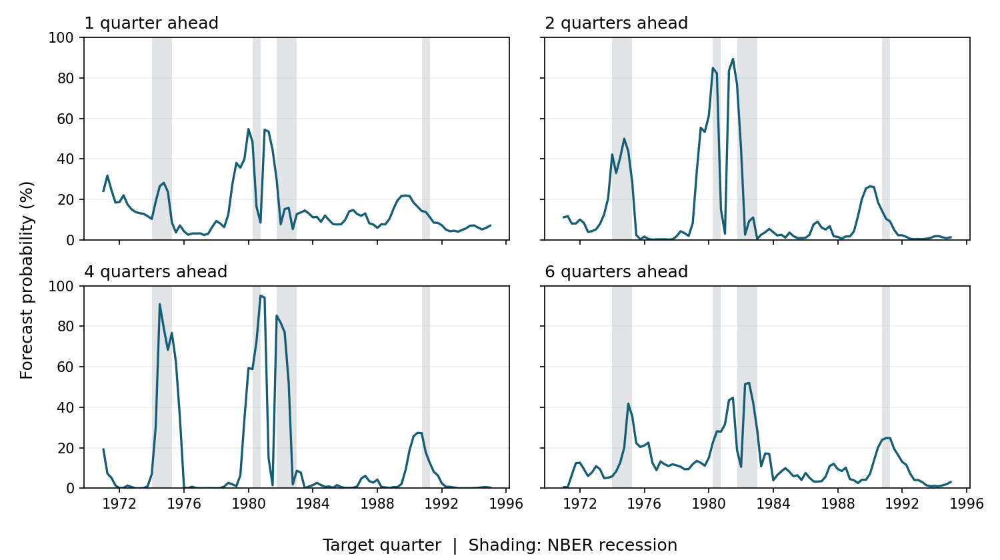

# 美国国债期限利差预警衰退：复现结果

**美国利差模型部分复现。** 提前一年对 1990Q4 的预测为 27.23%, 论文报告 25%。全样本 12 个概率档的反推利差平均绝对差为 0.078 个百分点。三种竞争指标的原口径长序列未取得, 原文关于各指标排名的结论仍待独立复核。

## 利差与衰退概率

141 个季度配对, 目标期 1960Q1 至 1995Q1。重估结果为 P(衰退)=Φ(−0.58809−0.78381×利差)。系数为最大似然点估计, 利差以百分点计。输入 1981Q1 与 1994Q3 的季度利差分别为 −2.182 与 +2.743, 对四季度后的模型概率为 86.91% 与 0.31% (原文 86.5% 与 0.2%)。这是全样本拟合。12 档阈值的绝对差在 0.015 至 0.138 个百分点之间, 详见 [逐档对照](../outputs/thresholds.csv)。

## 真正在预测起点截断训练后

| 目标为 1990Q4 | 起报季度 | 训练季度数 | 论文 | 复现 |
| --- | --- | ---: | ---: | ---: |
| 提前 1 季度 | 1990Q3 | 123 | 13% | 14.29% |
| 提前 2 季度 | 1990Q2 | 122 | 正文未单列 | 14.35% |
| 提前 4 季度 | 1989Q4 | 120 | 25% | 27.23% |
| 提前 6 季度 | 1989Q2 | 116 | 22% | 23.90% |

1971Q1 至 1995Q1 共有 97 个样本外目标季度, 其中 14 个属于衰退, 对应四轮衰退。作为描述性核查, Brier 分数是预测概率与 0/1 实现值之差的均方, 越低越好。每期基准为当次训练样本的衰退占比, 各期限采用相同目标季。分数为本次计算, 未检验期限间差异的显著性。

| 提前季度数 | 利差模型 | 历史频率基准 |
| ---: | ---: | ---: |
| 1 | 0.1231 | 0.1252 |
| 2 | 0.0967 | 0.1273 |
| 4 | 0.0816 | 0.1289 |
| 6 | 0.0995 | 0.1283 |

四季度模型对衰退季的平均预测为 53.57%, 对扩张季为 8.35%。最强的两次信号反而是误报：1980Q4 为 95.13%, 1981Q1 为 94.07%。这两季处于前后两轮衰退之间。以“未来一年中只要出现过衰退就算命中”的规则打分会改变问题。

## 差异与复现边界

短文给出 1960Q1 起的四季度模型, 技术论文将原始序列起点写作 1959Q1。本次将 1959 年用于预热, 固定目标起点 1960Q1。短债按 91 天近似转换。缺少作者的逐行估计输入, 两处利差对齐仍不足以确定剩余阈值差异究竟来自哪条观测或哪种约定。每个期限只使用一套设定。季度样本外预测使用最终商业周期定年, 未逐期恢复公告时间。

原数据说明提供邮寄磁盘方式。NYSE 需要月内收盘价的平均值, 商务部 LEAD 需要当时的 11 项综合指标与两个月发布滞后, Stock-Watson XLI 需要原版领先指数与一个月滞后。查到的公开资料包括年度 NYSE 表、覆盖较短的历史指数与零散 XLI 公告, 尚不足以重建三者同口径的全样本。本文的 Brier 基准仅为历史频率。跨国迁移需另定各国样本和衰退标签。

## 重跑

从 replications/macro-ind-001 目录依次执行。Python 依赖版本记录在 requirements.txt。只重跑估计时, 可保留首次抓取的季度面板并直接运行 scripts/03_spread.py。

~~~sh
python -m venv .venv
.venv/bin/python -m pip install -r requirements.txt
.venv/bin/python scripts/01_fetch_and_clean.py
.venv/bin/python scripts/03_spread.py
.venv/bin/python scripts/verify_timing.py
~~~

[原文概率表及图](https://www.newyorkfed.org/medialibrary/media/research/current_issues/ci2-7.pdf) · [技术论文及附录 B](https://www.newyorkfed.org/medialibrary/media/research/staff_reports/research_papers/9609.pdf) · [逐季预测](../outputs/forecasts.csv) · [数据流程](02_data_flow.md)
